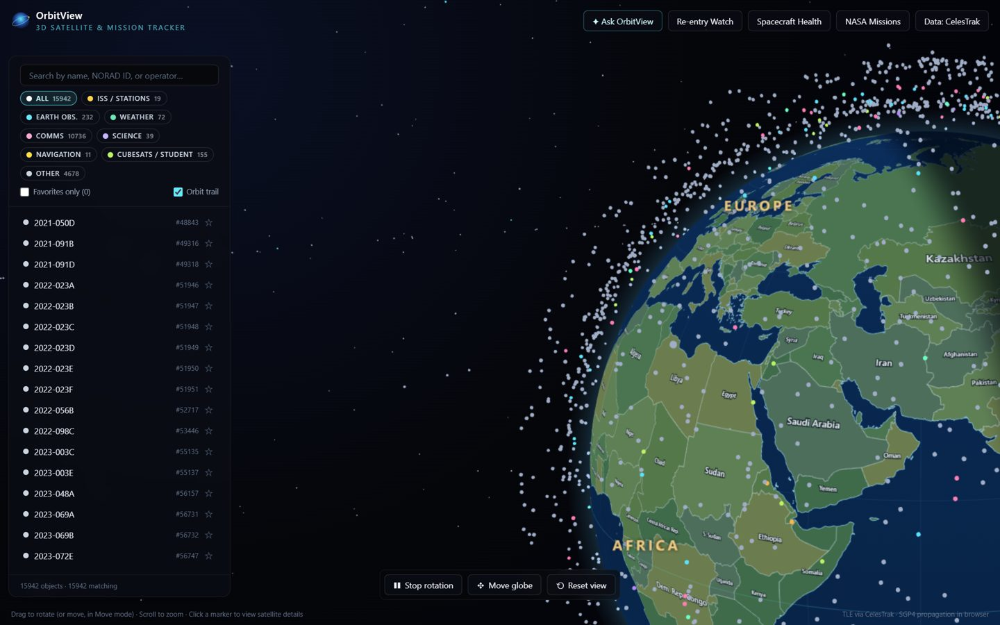
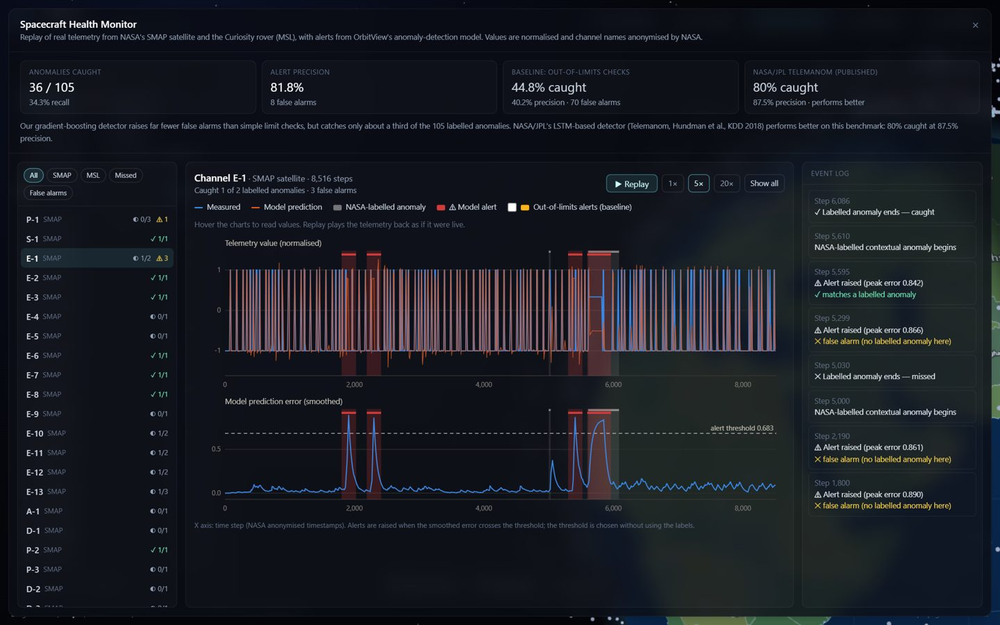
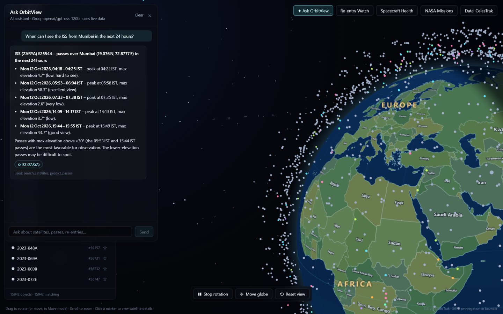
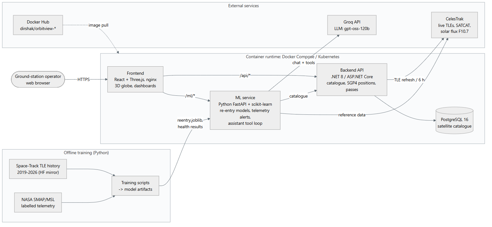

# OrbitView

A cloud-native satellite ground-station prototype: live tracking of ~16,000 satellites on a 3D globe, pass prediction for a ground station, machine-learning re-entry forecasts, ML alerts on real spacecraft telemetry, and an AI assistant that answers questions from the system's own data.

Built for the Cloud Computing mini project (use case: **SomaiyaSat & SomaiyaPod**), with four cloud experiments: Docker & Docker Hub, Kubernetes, resource right-sizing and FinOps instance comparison.



## Features

| Feature | What it does |
|---|---|
| 3D globe | All active satellites from CelesTrak on a map with country borders; rotate, move and reset controls |
| Ground-station passes | Next passes over a chosen location (Mumbai by default) with start/peak/end, max elevation and calendar export |
| Re-entry Watch (ML) | Gradient-boosted classifier + 3 quantile models forecast whether and when low-orbit objects re-enter, with a calibrated 80% window |
| Spacecraft Health (ML) | Per-channel anomaly detection on NASA SMAP/MSL telemetry, with a replay dashboard and event log |
| Ask OrbitView (LLM) | Groq-hosted LLM with 7 tools (search, position, passes, re-entry forecasts, missions); never invents data |

| | |
|---|---|
|  |  |

## Architecture



| Service | Stack | Port |
|---|---|---|
| `frontend` | React 18, TypeScript, Three.js, Tailwind, nginx | 8080 |
| `backend` | .NET 8 / ASP.NET Core, EF Core, SGP4 | 5080 |
| `ml-service` | Python 3.12, FastAPI, scikit-learn, Groq API | 5090 |
| `postgres` | PostgreSQL 16 | 5432 |

nginx serves the web app and proxies `/api/*` to the backend and `/ml/*` to the ML service.

## Quick start

Requirements: Docker Desktop.

```bash
git clone https://github.com/dirshak/OrbitView.git
cd OrbitView
cp .env.example .env          # optional: add GROQ_API_KEY for the assistant
docker compose up -d --build
```

Open http://localhost:8080. The backend downloads current orbital data from CelesTrak on start-up; the ML service scores the catalogue once it is available.

### Configuration (`.env`)

| Variable | Purpose |
|---|---|
| `GROQ_API_KEY` | Enables the assistant (get a key at console.groq.com). Used only server-side. |
| `GROQ_MODEL` | Groq chat model with tool use (default `openai/gpt-oss-120b`) |
| `POSTGRES_*`, `ConnectionStrings__Postgres` | Database settings |
| `ASPNETCORE_ENVIRONMENT` | `Production` (default) |

## Run from Docker Hub

Images: `dirshak/orbitview-frontend`, `dirshak/orbitview-backend`, `dirshak/orbitview-ml-service` (tags `1.0.1`, `latest`).

```powershell
$env:DOCKERHUB_USER = "dirshak"
docker compose -f deploy/dockerhub/docker-compose.hub.yml -p orbitview-hub up -d   # http://localhost:8081
```

To publish your own build: `powershell -File deploy/dockerhub/push.ps1 -User <dockerhub-user> -Version 1.0.1`.

## Run on Kubernetes

Tested on Docker Desktop's built-in Kubernetes (v1.30).

```bash
kubectl apply -f deploy/k8s/orbitview.yaml
kubectl -n orbitview create secret generic orbitview-secrets --from-literal=GROQ_API_KEY=<key>   # optional
kubectl -n orbitview get pods,svc                                    # http://localhost:8090
kubectl -n orbitview scale deployment/ml-service --replicas=3        # scaling
kubectl -n orbitview delete pod <ml-service-pod>                     # self-healing
```

Captured outputs from the experiment are in `deploy/k8s/evidence/`.

## Experiments 7 and 8 (right-sizing and FinOps)

A k6 load test drives the ML service under Docker CPU/memory limits that simulate cloud instance types; costs are calculated from public AWS (Mumbai) list prices. No cloud resources are used.

```bash
ml-service/.venv/Scripts/python experiments/finops/run_experiments.py all   # needs the stack running
ml-service/.venv/Scripts/python experiments/finops/analyze.py
```

Results: `EXPERIMENTS_7_8.txt` and `experiments/finops/charts/`.

## Machine learning

Full description of every model, formula and result: [`AI_FEATURES.txt`](AI_FEATURES.txt).

| Model | Data | Test result |
|---|---|---|
| Re-entry classifier | Space-Track TLE history 2019-2026, CelesTrak decay dates, F10.7 solar flux | ROC AUC 0.983, F1 0.866 (physics baseline 0.739) |
| Re-entry quantile models | same | median error 0.6 days (final week) to 35 days (6-12 months); 80% window covers 79.8% |
| Telemetry anomaly detection | NASA SMAP & MSL (Hundman et al., KDD 2018) | 36/105 anomalies caught at 81.8% precision; NASA's published LSTM detector performs better (80% recall) |

Trained models are included in `ml-service/models/`. To retrain (downloads ~800 MB of public data):

```bash
cd ml-service
python -m venv .venv && .venv/Scripts/pip install -r requirements-train.txt
python training/download_history.py 2019 2026 && python training/build_dataset.py && python training/train.py
python training/download_smap_msl.py && python training/train_anomaly.py
```

See `ml-service/README.md` for details.

## ML service API

| Endpoint | Description |
|---|---|
| `GET /ml/health` | Status, objects scored, assistant configured |
| `GET /ml/reentry/{noradId}` | Re-entry forecast for one satellite |
| `GET /ml/reentry?within_days=30` | Watch list, soonest first |
| `POST /ml/reentry/predict` | Score any TLEs (one or a batch) |
| `GET /ml/reentry/model-card` | Training data and test metrics |
| `GET /ml/telemetry/summary`, `GET /ml/telemetry/channels/{id}` | Spacecraft Health data |
| `POST /ml/assistant/chat` | Assistant conversation |

## Project structure

```
frontend/              React + Three.js web app, nginx config
backend/               .NET 8 API: catalogue, SGP4 positions, pass prediction
ml-service/
  app/                 FastAPI: re-entry predictor, telemetry API, Groq assistant
  training/            data download, dataset building, training, evaluation
  models/              trained models and metrics
experiments/finops/    load test, experiment runner, analysis, prices
deploy/dockerhub/      push script, push log, compose file for Hub images
deploy/k8s/            Kubernetes manifest and captured outputs
AI_FEATURES.txt        AI features and calculations
EXPERIMENTS_7_8.txt    right-sizing and FinOps results
```

## Data sources

- Orbital data, satellite catalogue and space weather: [CelesTrak](https://celestrak.org)
- TLE history: Space-Track.org via the Hugging Face dataset `juliensimon/space-track-tle-history`
- Spacecraft telemetry anomalies: NASA/JPL SMAP & MSL dataset (Hundman et al., KDD 2018)
- Map: Natural Earth (public domain) via `world-atlas`

## License

MIT - see [LICENSE](LICENSE).
